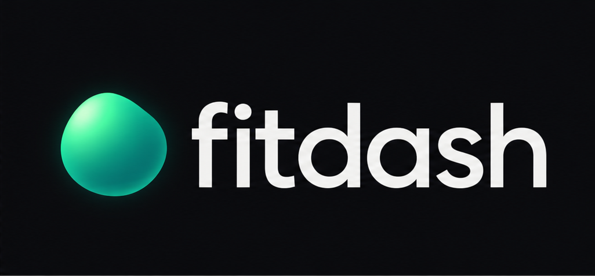

<p align="center"></p>

# fitdash

Site: https://mayurrawte.is-a.dev/fitdash/

A calm, animated Health Connect dashboard for Android. Recovery, sleep, activity and trends on four swipeable pages, in five themes, from whatever your watch or ring writes to Health Connect.

- No account, no cloud, no internet permission. Your data stays on your phone.
- Reads every Health Connect data type and shows only what you have.

## Your data stays yours

fitdash is built so that your health data cannot leave your phone unless you send it.

- **No server, no API, no account.** There is no backend. Nothing to sign up for.
- **No internet permission.** The release APK requests no `INTERNET` permission, so the app cannot send data anywhere.
- **Read-only.** fitdash only reads from Health Connect. It never writes to it.
- **No analytics, crash reporting, ads or trackers.** The only third-party libraries are AndroidX/Compose, the Health Connect client and Haze (blur).
- **Nothing leaves unless you share it.** "Ask AI" and "Share day" open the Android share sheet. You pick the app; fitdash sends nothing itself.

Read the full [privacy policy](https://mayurrawte.is-a.dev/fitdash/privacy.html).

### Verify it yourself

Don't take our word for it. Check the APK you downloaded:

```
# 1. No INTERNET permission (only Health Connect READ permissions)
aapt dump permissions fitdash.apk

# 2. Signing certificate matches the one below
apksigner verify --print-certs fitdash.apk
```

Expected SHA-256 of the signing certificate:

```
15:9A:A2:14:AC:84:59:08:E6:D4:30:90:2D:50:D4:FA:85:AA:9C:E1:92:21:E7:9C:E7:3A:83:CA:B5:9E:55:72
```

(plain hex: `159aa214ac845908e6d430902d50d4fa85aa9ce19221e79ce73a83cab59e5572`)

You can also read [`app/src/main/AndroidManifest.xml`](app/src/main/AndroidManifest.xml), or build it yourself with `./gradlew :app:assembleGithubRelease`. Release APKs are built and signed by GitHub Actions from this public source ([`release.yml`](.github/workflows/release.yml)), triggered by version tags.

To report a vulnerability, see [SECURITY.md](SECURITY.md).

## Install

Download the latest APK: **[fitdash.apk](https://github.com/mayurrawte/fitdash/releases/latest/download/fitdash.apk)** (all builds on the [releases page](https://github.com/mayurrawte/fitdash/releases)). Needs Android 8+ and Health Connect.

## Build

Requires JDK 17 and the Android SDK.

```
./gradlew :app:installGithubDebug
```

## Publishing

Google Play builds, the store listing and the release checklist are in [docs/play/PUBLISHING.md](docs/play/PUBLISHING.md).

## Licence

GPL-3.0. See [LICENSE](LICENSE).

The fitdash name and icon are not covered by the licence. Forks must use a different name and icon.
